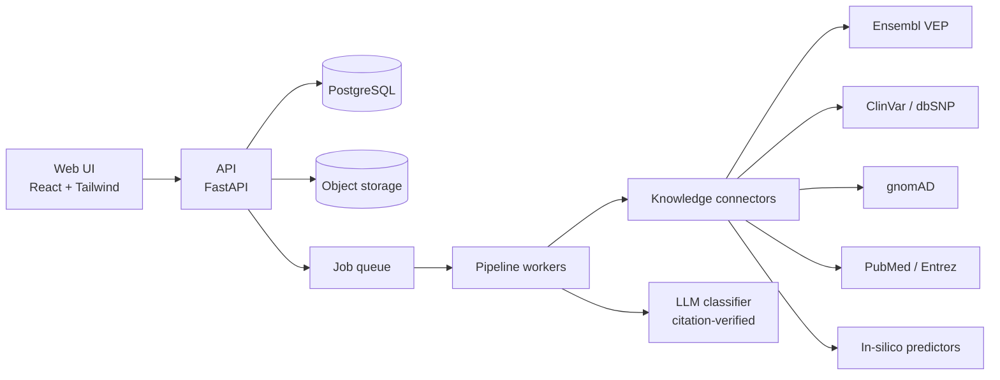
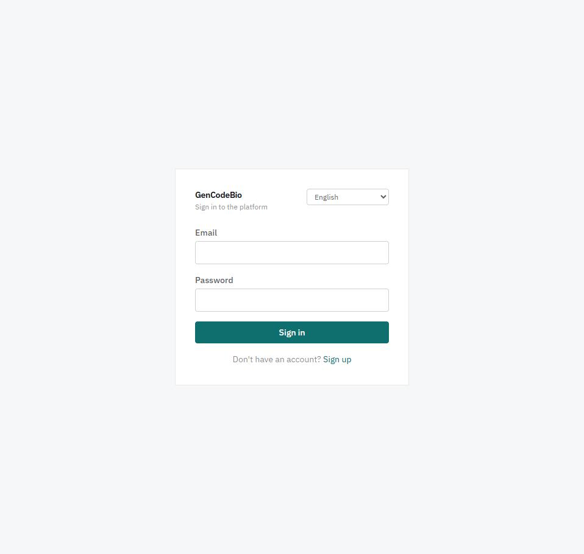
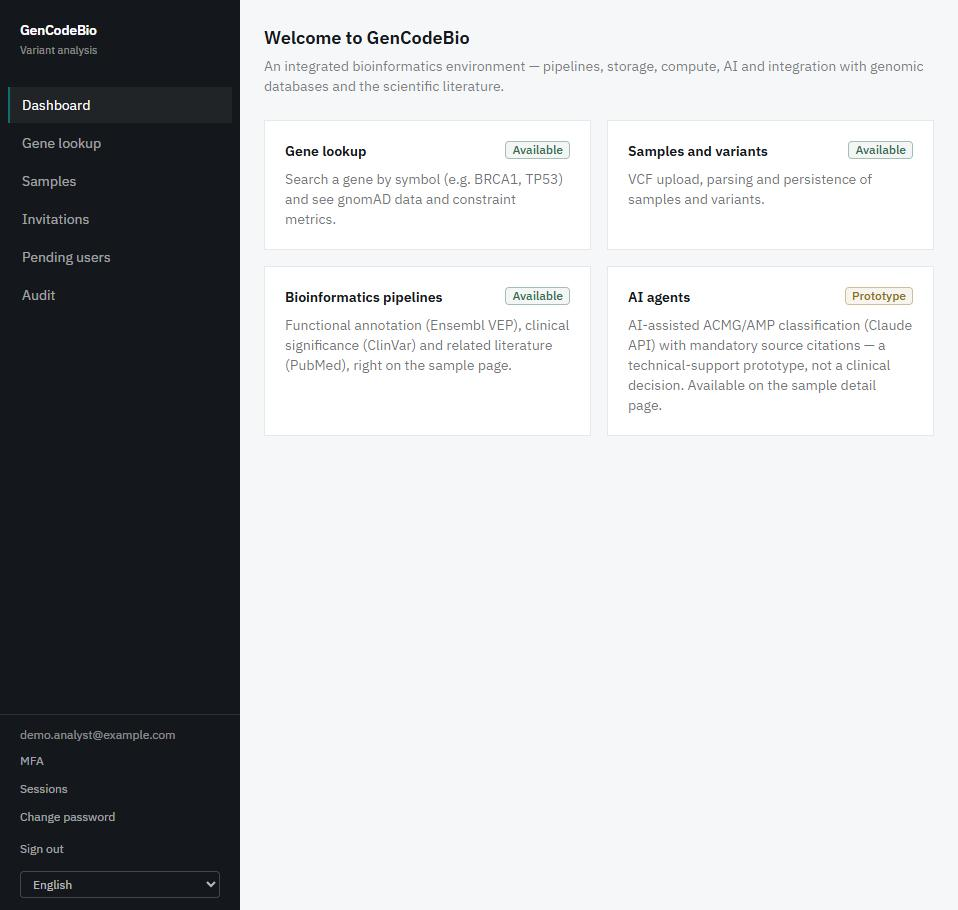
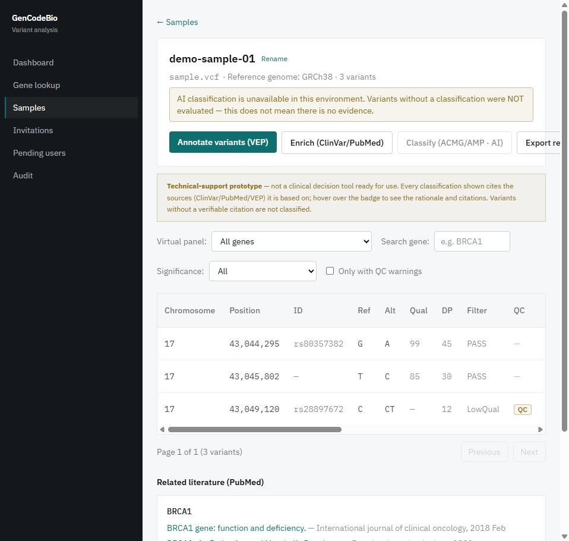
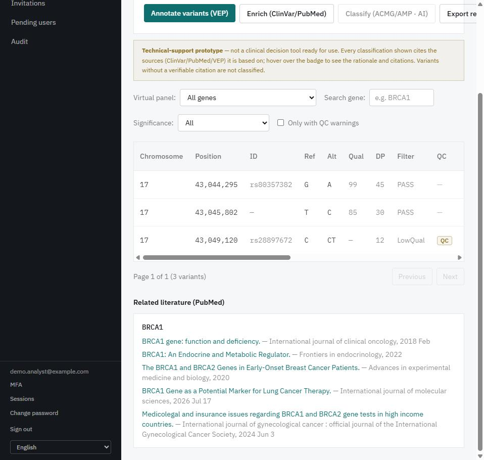

# GenCodeBio

**An integrated, web-based bioinformatics workbench for clinical genomics — from raw variant data to an evidence-backed, auditable interpretation.**

> 🇧🇷 [Leia em português](README.pt-BR.md)

> **Status:** active development · **Research Use Only (RUO)** · no real patient data is processed.
> This repository is a **public showcase** (architecture, design decisions, selected material).
> The production source code is private and proprietary. See [LICENSE](LICENSE) and [NOTICE](NOTICE).

---

## Why this exists

Clinical genomics is split across dozens of tools and databases. GenCodeBio aims to be one platform
that serves the whole chain of roles: clinical bioinformatics analysts, variant curators, genomic data
engineers, R&D bioinformaticians, oncology/somatic analysts and molecular modelers — while keeping
every conclusion traceable to its source.

## What works today

- **Variant pipeline:** VCF upload (streaming parser, bulk insert) → input QC (depth, QUAL, FILTER, Ti/Tv, genome-build detection) → annotation with **Ensembl VEP** (canonical / MANE Select transcript) → enrichment with **ClinVar**, **gnomAD**, **PubMed** and in-silico predictors (**REVEL, AlphaMissense, CADD**).
- **ACMG/AMP classification assisted by an LLM**, with a hard rule: *a result without a valid, verifiable source citation is discarded and never persisted.* Criteria are validated structurally against the evidence actually available.
- **Curated virtual gene panels**, **PDF reports**, **variant search/filtering**, large-file upload through signed URLs, batched asynchronous processing.
- **Security & governance:** cookie-based sessions with server-side revocation, RBAC, TOTP MFA, invite-only registration with admin approval, rate limiting, security headers, full audit trail.
- **International by design:** the UI is available in English, Portuguese, Spanish and French, chosen at sign-in; API errors carry stable codes that the frontend translates, and CI fails if a translation is missing.
- **Zero-cost local profile** *(implemented in the repository)*: ports and adapters for the job queue, object storage, e-mail and the LLM, chosen by a runtime profile. One `docker compose up` brings up a migrated PostgreSQL, S3-compatible storage, the API and the UI on a laptop, with no cloud spend. Locally the LLM classifier is off by default, and when it is off the API says so explicitly instead of returning an unsupported result.
- **Local reference data** *(implemented in the repository)*: the official Ensembl VEP cache run as a local service (REST vs local equivalence checked on 330 of 330 variants), a versioned ClinVar snapshot matched by **allele** rather than by rsID, and region-sliced gnomAD v4.1 for the 33 genes of the curated panels. A coverage rule turns "outside the sliced regions" into an explicit technical failure — never a false "absent from gnomAD". While validating the ClinVar snapshot we measured that the public rsID lookup returned another allele's record for 66 of 129 multi-record rsIDs; the local backend fixes this by construction.
- **Provenance and reinterpretation** *(implemented in the repository)*: every PDF report carries a traceability section (software image, database versions and dates, model and prompt hash), and a read-only API endpoint compares the stored evidence with the current local snapshot and flags classifications that may be out of date. It never reclassifies by itself.
- **Command-line client** *(implemented in the repository)*: `gencodebio` — sign-in with MFA, upload, run pipeline stages, list variants, download the PDF report, inspect provenance. Passwords never go on the command line, only the session token is stored (owner-only file permissions), and logout revokes the session on the server. It uses the public API only.
- **Operations** *(implemented in the repository)*: a readiness endpoint that checks the database (the plain health check deliberately does not), SBOM generation and a container vulnerability scan in CI.
- **Quality:** 585 automated backend tests (also run against a real PostgreSQL in CI), 42 frontend tests and 26 CLI tests; CI on every push, dependency auditing as a merge gate, an OWASP ZAP baseline scan, and a documented stage-by-stage delivery history.

> **Release note:** the items marked *implemented in the repository* are built and tested but not yet deployed to the hosted instance, which will be upgraded in a planned release.

## Architecture (high level)

Design principles — details in [docs/architecture.md](docs/architecture.md):

1. **Ports and adapters.** Queue, storage, database, LLM and every external knowledge source sit behind an interface, so the same code can run at zero cost locally and scale out later by configuration only. (Queue, storage, e-mail, the LLM and the knowledge sources already work this way; the database is a PostgreSQL container locally and managed PostgreSQL in the cloud.)
2. **Provenance first.** Every annotation records which database/build/version produced it.
3. **Evidence over eloquence.** The AI layer may only assert what it can cite.
4. **Compliance by construction.** LGPD/GDPR-aware data handling, audit logging, and a quality system aligned with IEC 62304 / ISO 14971 from the start.

## Screenshots

Captured from a local development instance with **synthetic demo data** (no real patient data; no AI classification was run, which the UI states explicitly).

| Sign-in (language chosen at sign-in) | Dashboard |
|---|---|
|  |  |

| Sample view: pipeline actions, filters, QC flags | Related literature (PubMed) |
|---|---|
|  |  |

## Roadmap

| Area | Status |
|---|---|
| Single-sample germline interpretation | ✅ working |
| Zero-cost local profile (ports & adapters: queue, storage, e-mail, LLM, knowledge sources) | ✅ built and tested (deployment to the hosted instance pending) |
| Multilingual UI (EN / PT / ES / FR; more languages by configuration) | ✅ working |
| Local reference data (VEP cache, ClinVar snapshot, gnomAD slices) + reinterpretation endpoint | ✅ built and tested (deployment pending) |
| Command-line client | ✅ built and tested |
| Reinterpretation screen in the UI, periodic re-checks | 🔜 next |
| FASTQ → VCF workflows (Nextflow / nf-core) | 🔜 planned |
| Trio / multi-sample, CNV & structural variants | 🔜 planned |
| Somatic oncology (COSMIC, OncoKB, cBioPortal) | 🔜 planned |
| Brazilian population resources (ABraOM, BIPMed) | 🔜 under evaluation |
| Cheminformatics / molecular modeling module | 🔜 planned |
| Open standards (GA4GH, HL7 FHIR Genomics) | 🔜 planned |

## Stack

Python · FastAPI · SQLAlchemy/Alembic · PostgreSQL · React · TypeScript · Tailwind · Docker · Google Cloud Run · GitHub Actions. Planned: Nextflow, Rust/C++ hot paths, R/Quarto, containerized scientific tools.

## About the author

**Mailson Rodrigues** — biomedical scientist and software developer working at the intersection of
clinical genetics, molecular pathology and software engineering. Open to conversations with
investors, collaborators and teams in genomics and digital health.

GitHub: [@mailson-rodrigues](https://github.com/mailson-rodrigues)

## Contact & licensing

For partnership, investment or licensing inquiries, please open an issue titled **"Contact"** or use
the contact details on the GitHub profile. Commercial use, redistribution, and use of this material to
build competing products are **not permitted** — see [LICENSE](LICENSE).

© 2026 Mailson Rodrigues. All rights reserved except as stated in the license.
