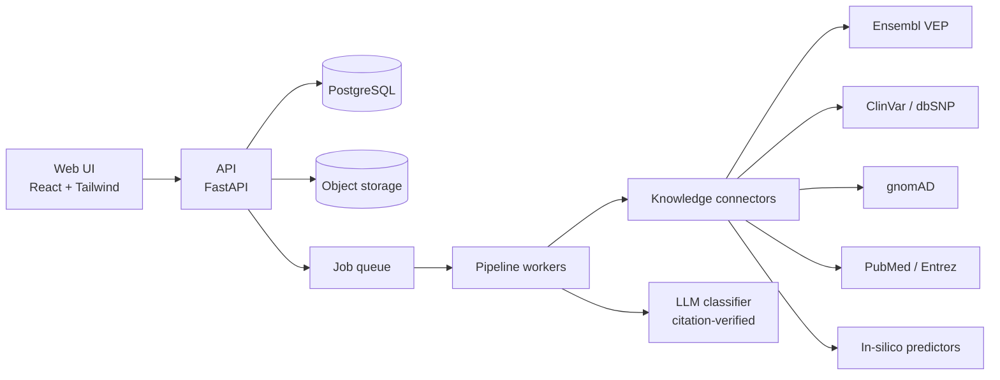

# GenCodeBio

**An integrated, web-based bioinformatics workbench for clinical genomics — from raw variant data to an evidence-backed, auditable interpretation.**

> 🇧🇷 [Leia em português](README.pt-BR.md)

> **Status:** active development · **Research Use Only (RUO)** · no real patient data is processed.
> This repository is a **public showcase** (architecture, design decisions, selected material).
> The production source code is private and proprietary. See [LICENSE](LICENSE) and [NOTICE](NOTICE).

---

## Why this exists

Clinical genomics is split across dozens of tools and databases. GenCodeBio aims to be one platform
that serves the whole chain of roles: clinical bioinformatics analysts, variant curators, genomic data
engineers, R&D bioinformaticians, oncology/somatic analysts and molecular modelers — while keeping
every conclusion traceable to its source.

## What works today

- **Variant pipeline:** VCF upload (streaming parser, bulk insert) → input QC (depth, QUAL, FILTER, Ti/Tv, genome-build detection) → annotation with **Ensembl VEP** (canonical / MANE Select transcript) → enrichment with **ClinVar**, **gnomAD**, **PubMed** and in-silico predictors (**REVEL, AlphaMissense, CADD**).
- **ACMG/AMP classification assisted by an LLM**, with a hard rule: *a result without a valid, verifiable source citation is discarded and never persisted.* Criteria are validated structurally against the evidence actually available.
- **Curated virtual gene panels**, **PDF reports**, **variant search/filtering**, large-file upload through signed URLs, batched asynchronous processing.
- **Security & governance:** cookie-based sessions with server-side revocation, RBAC, TOTP MFA, invite-only registration with admin approval, rate limiting, security headers, full audit trail.
- **Quality:** 279 automated backend tests, CI on every push, dependency auditing, a documented stage-by-stage delivery history.

## Architecture (high level)

Design principles — details in [docs/architecture.md](docs/architecture.md):

1. **Ports and adapters everywhere.** Queue, storage, database, LLM and every external knowledge source sit behind an interface, so the same code runs at zero cost locally and scales out later by configuration only.
2. **Provenance first.** Every annotation records which database/build/version produced it.
3. **Evidence over eloquence.** The AI layer may only assert what it can cite.
4. **Compliance by construction.** LGPD/GDPR-aware data handling, audit logging, and a quality system aligned with IEC 62304 / ISO 14971 from the start.

## Roadmap

| Area | Status |
|---|---|
| Single-sample germline interpretation | ✅ working |
| Multilingual UI (EN / PT / ES / FR and more) | 🔜 next |
| Local reference snapshots (VEP cache, ClinVar, gnomAD) | 🔜 planned |
| FASTQ → VCF workflows (Nextflow / nf-core) | 🔜 planned |
| Trio / multi-sample, CNV & structural variants | 🔜 planned |
| Somatic oncology (COSMIC, OncoKB, cBioPortal) | 🔜 planned |
| Brazilian population resources (ABraOM, BIPMed) | 🔜 under evaluation |
| Cheminformatics / molecular modeling module | 🔜 planned |
| Open standards (GA4GH, HL7 FHIR Genomics) | 🔜 planned |

## Stack

Python · FastAPI · SQLAlchemy/Alembic · PostgreSQL · React · TypeScript · Tailwind · Docker · Google Cloud Run · GitHub Actions. Planned: Nextflow, Rust/C++ hot paths, R/Quarto, containerized scientific tools.

## About the author

**Mailson Rodrigues** — biomedical scientist and software developer working at the intersection of
clinical genetics, molecular pathology and software engineering. Open to conversations with
investors, collaborators and teams in genomics and digital health.

GitHub: [@mailson-rodrigues](https://github.com/mailson-rodrigues)

## Contact & licensing

For partnership, investment or licensing inquiries, please open an issue titled **"Contact"** or use
the contact details on the GitHub profile. Commercial use, redistribution, and use of this material to
build competing products are **not permitted** — see [LICENSE](LICENSE).

© 2026 Mailson Rodrigues. All rights reserved except as stated in the license.
